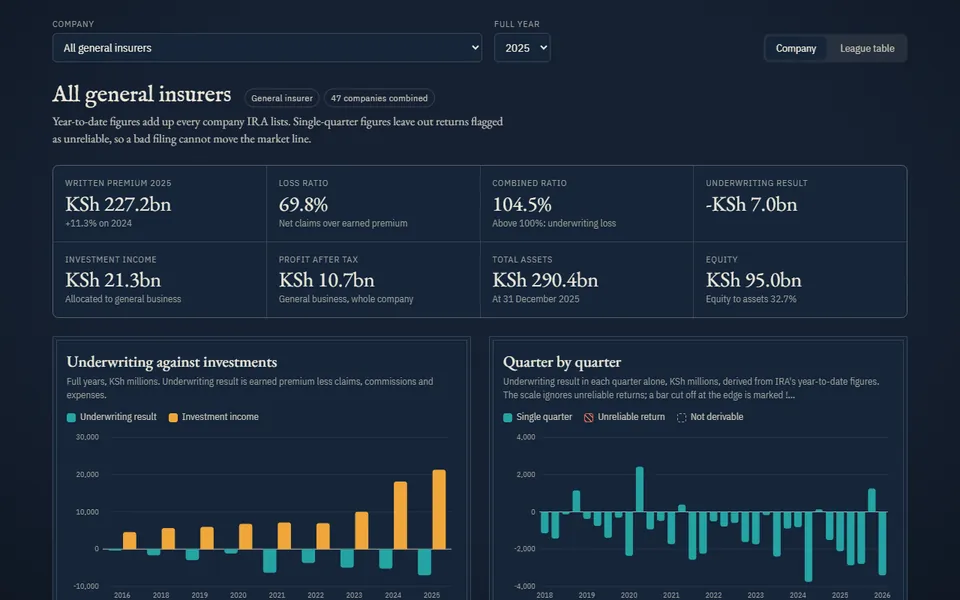
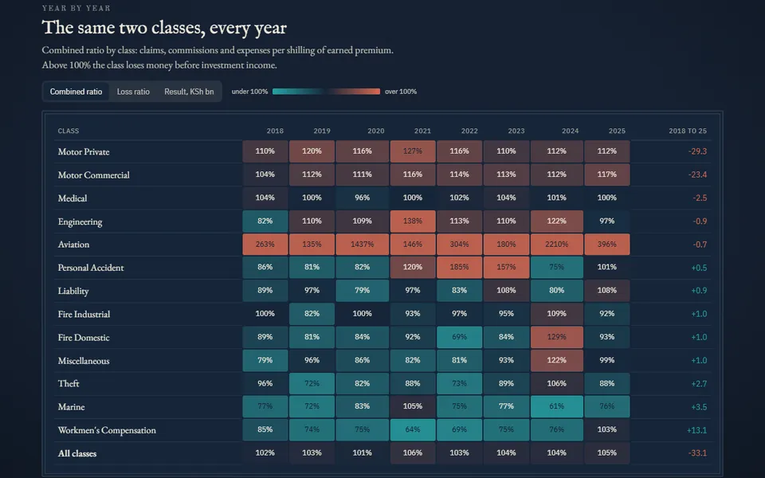
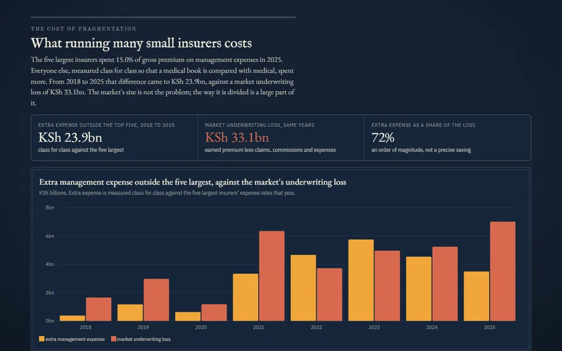
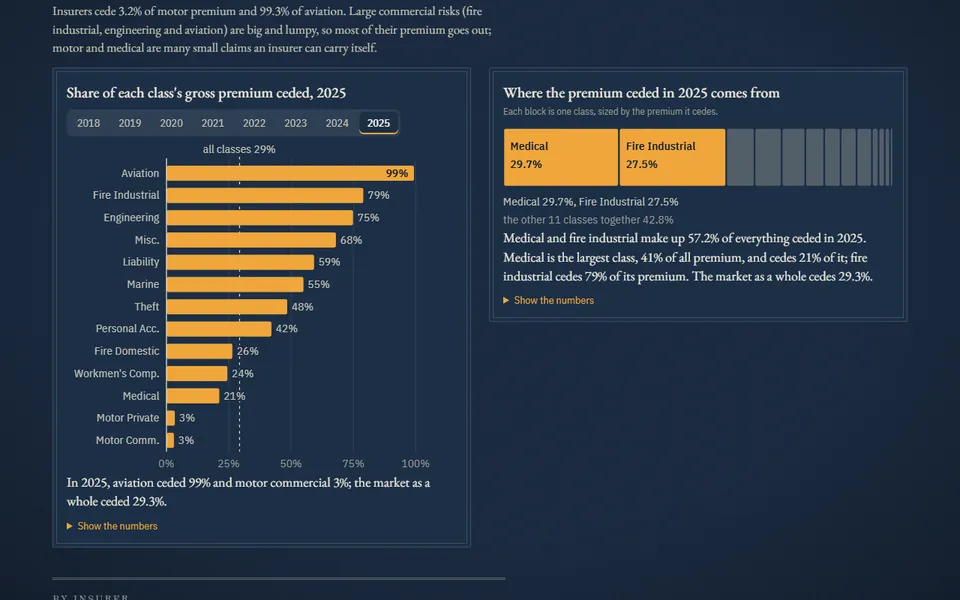
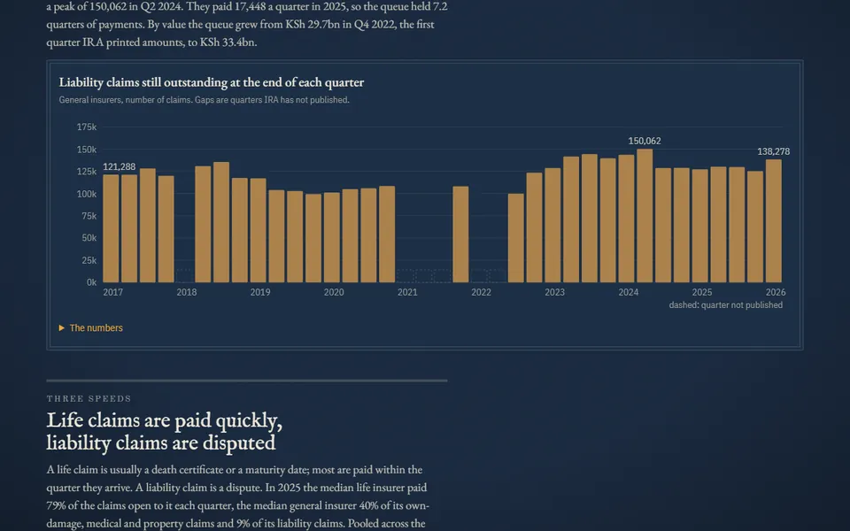
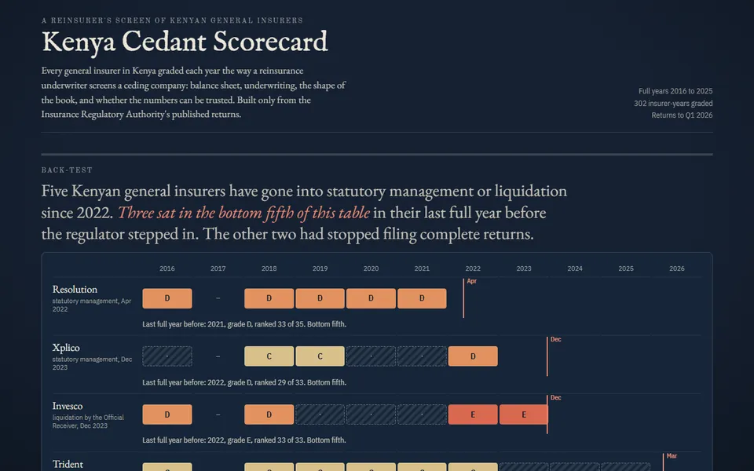

<p align="center">
  
</p>

<h1 align="center">Kenya Insurance Data</h1>

<p align="center">
  <b>Every Kenyan general insurer, every quarter from Q4 2016 to Q1 2026,<br>
  rebuilt from the regulator's own statistics and checked against itself 42,246 times.</b>
</p>

<p align="center">
  <a href="https://maidenpeter.github.io/ira-kenya-data/explorer/kenya-insurer-explorer.html"><b>Open the Insurer Explorer</b></a>
  &nbsp;|&nbsp; <a href="#what-the-data-already-shows">What it shows</a>
  &nbsp;|&nbsp; <a href="#how-it-is-checked">How it is checked</a>
  &nbsp;|&nbsp; <a href="#built-on-this-data">Built on it</a>
  &nbsp;|&nbsp; <a href="#rebuilding">Rebuilding</a>
  &nbsp;|&nbsp; <a href="#why-i-built-this">Why I built this</a>
</p>

<p align="center"><sub>A portfolio project by Marion Peter. Public data from the Insurance Regulatory Authority, Kenya. Unaudited returns, as published.</sub></p>

<p align="center">
  <a href="https://maidenpeter.github.io/ira-kenya-data/explorer/kenya-insurer-explorer.html"></a>
</p>

## In one minute

The Insurance Regulatory Authority (IRA) publishes every insurer's accounts each quarter. They arrive as a mix of PDFs and
Excel workbooks with shifting layouts and inconsistent labels, and the same company can appear under three or four names.

This repository turns them into clean, long-format tables where every figure can be traced back to the file, sheet and
row it came from. It is the data layer for the Kenya series: an insurance analysis and a reinsurer's scorecard are
built on it, and a browser page lets anyone look up any company in any year.

<table>
  <tr>
    <td align="center" width="25%"><h3>35</h3><sub>quarters, Q4 2016 to Q1 2026</sub></td>
    <td align="center" width="25%"><h3>52</h3><sub>companies, every name IRA has used tied to one id</sub></td>
    <td align="center" width="25%"><h3>42,246</h3><sub>checks on the accounts, plus 12,791 on the claims tables</sub></td>
    <td align="center" width="25%"><h3>165</h3><sub>source files, each listed with its IRA link and SHA-256</sub></td>
  </tr>
</table>

> [!NOTE]
> The raw IRA files and the tables built from them are not published here. `./run_all.sh` builds the tables locally,
> and `data/raw/manifest.csv` lists every source file with its link and hash, so a copy can be checked against the one
> used. This repository holds the code, the company crosswalk, the return-quality flags, the validation summary and the
> explorer page.

## What the data already shows

In every full year in this data, Kenya's general insurers as a group lost money on underwriting and made it back on investments.

| Year | Active insurers | Gross premium (KSh bn) | Loss ratio | Combined ratio | Underwriting result (KSh bn) | Investment income (KSh bn) |
|---|---|---|---|---|---|---|
| 2016 | 35 | 121.7 | 62.3% | 100.5% | -0.39 | 4.58 |
| 2018 | 37 | 129.0 | 62.2% | 101.8% | -1.65 | 5.66 |
| 2019 | 36 | 131.1 | 63.5% | 103.3% | -2.97 | 5.98 |
| 2020 | 35 | 130.8 | 63.6% | 101.3% | -1.18 | 6.78 |
| 2021 | 35 | 152.4 | 68.8% | 106.2% | -6.34 | 7.15 |
| 2022 | 33 | 168.9 | 67.9% | 103.3% | -3.72 | 6.97 |
| 2023 | 35 | 191.3 | 67.9% | 103.9% | -4.96 | 10.02 |
| 2024 | 34 | 204.1 | 70.4% | 103.8% | -5.24 | 18.15 |
| 2025 | 34 | 227.2 | 69.8% | 104.5% | -7.01 | 21.31 |

The local reinsurers tell a different story. They made an underwriting profit in six of the nine years, but slipped to a KSh 0.94bn loss in 2025, after earlier losses in 2018 and 2019.

Full years only (Q4, year to date). Gross premium is gross direct plus inward reinsurance. Loss and combined ratios are on net earned premium. 2017 is missing because IRA has no Q4 2017 workbook online.

Underwriting profit is also getting rarer. In 2016, 19 of the 35 active insurers made an underwriting profit. By 2025 only 9 of 34 did. Five insurers made an underwriting profit in every full year from 2018 to 2025: GA Insurance, ICEA Lion General, Intra-Africa Assurance, Mayfair and Tausi Assurance.

## How it is checked

`src/ira_data/validate.py` runs 42,246 checks, and `pytest tests` runs seven guards on the processed tables wherever they are built. On every push, GitHub Actions runs the guards on what is published: the crosswalk, the quality flags, the source manifest, and a check that no data table is tracked. The results are in `validation/SUMMARY.md`; the full list of checks is written locally and not published.

| Check | Passed |
|---|---|
| Every company's revenue account adds up line by line, on each of the four identities | 1,460 of 1,460 |
| Every class split adds to its total | 14,118 of 14,118 |
| Class tables agree with the revenue account | 11,169 of 11,173 |
| Company rows add to IRA's printed totals | 11,022 of 11,115 |

The balance sheets balance for all 1,388 company quarters, and the profit and loss accounts reconcile down to profit after tax under both IFRS 4 and IFRS 17, with the handful of exceptions listed in `validation/validation_statements.csv`.

**A return can add up on its own and still be wrong,** so each company is also read across its quarters. Intra-Africa Assurance, for example, reported KSh 4.3bn of year-to-date premium at Q3 2024 and KSh 2.75bn for the full year. A running total cannot fall like that. Left in, it puts a phantom KSh 2.4bn underwriting profit into the market's third quarter. Twelve such returns are flagged as errors and kept out of single-quarter market totals. So are the two quarters in which one insurer absorbed another's book mid-year (MUA taking in Saham in Q3 2021, Sanlam Allianz General taking in Sanlam General in Q4 2025), because the absorbed company's earlier quarters would otherwise be counted twice.

**Every failure traces to an error in IRA's own publications,** and each one is documented:

- IRA's Q4 2024 market total leaves out two micro insurers that it lists in the same table.
- The printed totals on two sheets in Q4 2025 and Q1 2026 are stale.
- In Q2 and Q3 2019, one reinsurer's inward premium was filed under direct premium.

**As an independent check,** twelve market figures were taken from IRA's PDF industry releases for 2020 to 2024: loss ratios, underwriting results and medical premium. All twelve agree exactly with the workbooks once micro insurers are counted with the insurers, as the releases do.

## Following a company through its name changes

IRA prints company names as they stood each quarter, so the same insurer can appear under three or four names. The crosswalk ties them together, and every link that rests on more than a spelling change cites a source:

- Phoenix of East Africa became MUA Insurance, which later absorbed Saham Assurance Kenya
- Cannon Assurance became Metropolitan Cannon, then Cannon General after Momentum Metropolitan sold out in 2022
- UAP became Old Mutual General in 2022
- AIG Kenya became NCBA Insurance after NCBA bought it in 2024
- Jubilee General became Jubilee Allianz, and now reports as Sanlam Allianz General

The panel's single-quarter figures add back to the full-year totals for all 3,300 company years checked. Quarters where IRA printed zeros because a company did not file are flagged and left blank, not turned into false swings.

## Claims settlement statistics

IRA also publishes each insurer's claims movement every quarter. `src/ira_data/extract_claims.py` reads the 32 workbooks published from Q1 2017 to Q1 2026, mapping each column by its heading because the layout changed several times, and `src/ira_data/build_claims_panel.py` joins the printed names to companies and runs 12,791 checks: the rows against IRA's printed industry line, each quarter's movement, each quarter against the one before, IRA's printed payment ratio, and counts that cannot be negative.

- The rows add up to the printed industry line in every table but two, both explained. In Q1 2020 IRA's printed life total leaves out Absa Life Assurance, in the first quarter it was printed under its new name: the gap in every column is Absa Life's row. In Q1 2017 the liability line is one claim higher than its rows.
- From Q3 2018 to Q2 2020 the column printed as "claims revived" does not add to the count; IRA prints the same column as "claims revised" from Q3 2020. It is read as revised for those eight quarters.
- 264 of 3,094 insurer-quarters do not add up from start to end, 152 do not start where the last quarter ended, and 8 print a negative count. They are kept as printed and counted; a negative count gets no payment ratio.
- Not in the data: Q1 2018 for general business, Q1 to Q3 2021 and Q1 to Q2 2022.

The analysis is in [ira-kenya-insurance](https://github.com/maidenpeter/ira-kenya-insurance), as analysis 2.

## Built on this data

Every page of the [Kenya series](https://maidenpeter.github.io/kenya-insurance/) reads these tables. Click a picture to open the page.

<table>
  <tr>
    <td width="33%" valign="top"><a href="https://maidenpeter.github.io/ira-kenya-data/explorer/kenya-insurer-explorer.html"></a><br><b>Insurer Explorer</b><br><sub>Any company or the whole market, any year: ratios, quarters, class mix, balance sheet and every quality flag. In this repository.</sub></td>
    <td width="33%" valign="top"><a href="https://maidenpeter.github.io/ira-kenya-insurance/page/kenya-insurance-loss-map.html"></a><br><b>Loss Map</b><br><sub>Where the money is lost, class by class, and what premiums would have to do. In <a href="https://github.com/maidenpeter/ira-kenya-insurance">ira-kenya-insurance</a>.</sub></td>
    <td width="33%" valign="top"><a href="https://maidenpeter.github.io/ira-kenya-insurance/page/kenya-insurance-market-structure.html"></a><br><b>Market Structure</b><br><sub>Who holds the market, what fragmentation costs, who came and went. In <a href="https://github.com/maidenpeter/ira-kenya-insurance">ira-kenya-insurance</a>.</sub></td>
  </tr>
  <tr>
    <td width="33%" valign="top"><a href="https://maidenpeter.github.io/ira-kenya-insurance/page/kenya-insurance-reinsurance-flows.html"></a><br><b>Reinsurance Flows</b><br><sub>How much risk insurers pass on, by class and company, and how the local reinsurers fare. In <a href="https://github.com/maidenpeter/ira-kenya-insurance">ira-kenya-insurance</a>.</sub></td>
    <td width="33%" valign="top"><a href="https://maidenpeter.github.io/ira-kenya-insurance/page/kenya-claims-settlement.html"></a><br><b>Claims Settlement</b><br><sub>Who pays claims, how fast, and the insurers the regulator stepped into. In <a href="https://github.com/maidenpeter/ira-kenya-insurance">ira-kenya-insurance</a>.</sub></td>
    <td width="33%" valign="top"><a href="https://maidenpeter.github.io/ira-kenya-reinsurance/page/kenya-cedant-scorecard.html"></a><br><b>Cedant Scorecard</b><br><sub>Every insurer graded A to E each year the way a reinsurer screens a cedant, back-tested against the five failures since 2022. In <a href="https://github.com/maidenpeter/ira-kenya-reinsurance">ira-kenya-reinsurance</a>.</sub></td>
  </tr>
</table>

## Tables

The tables are built locally by `./run_all.sh` from IRA's files and, like the raw files, they are not published. This repository holds the code that builds them, the company crosswalk, the return-quality flags, the validation summary and the explorer page.

| File | Rows | What it holds |
|---|---|---|
| `data/processed/general_revenue_accounts.csv` | 21,900 | The general business revenue account for every insurer and reinsurer: gross premium, inward and outward reinsurance, reserves, net earned premium, claims, commissions, expenses, underwriting result, investment income, operating result |
| `data/processed/general_by_class.csv` | 211,785 | The same companies split by 14 classes of business (motor private, medical, fire industrial and so on) across up to ten tables: gross premium, gross direct premium, inward premium, net premium, net earned premium, claims paid, claims incurred, commissions, management expenses, underwriting result |
| `data/processed/general_revenue_panel.csv` | 21,900 | The revenue accounts on stable company ids, with single-quarter figures derived from IRA's year-to-date numbers and a flag saying how each one was derived |
| `data/processed/general_by_class_panel.csv` | 211,785 | The class tables on stable company ids, with single-quarter figures |
| `data/processed/general_balance_sheets.csv` | 50,462 | Every company's general business balance sheet each quarter: equity, liabilities and 20 asset lines |
| `data/processed/general_profit_loss.csv` | 22,351 | Every company's profit and loss account, on IFRS 4 lines to Q4 2023 and IFRS 17 lines from Q1 2024 |
| `reference/company_crosswalk.csv` | 82 | Every spelling of every company name IRA has used, mapped to 52 companies, with the rename, merger or exit behind each change and a source link |
| `data/processed/claims_settlement.csv` | 4,473 | IRA's quarterly claims settlement statistics as printed: every insurer's claims movement (outstanding at the start, reported, revived, paid, declined, closed as no claim, outstanding at the end) for general liability, general non-liability and long-term business, in numbers and, from Q4 2022, amounts |
| `data/processed/claims_panel.csv` | 4,469 | The same on stable company ids, one row per company and quarter, with IRA's payment ratio |
| `reference/claims_crosswalk.csv` | 227 | Every insurer name printed in the claims tables, mapped to 48 general and 29 life companies |
| `validation/CLAIMS_SUMMARY.md` | | The checks on the claims tables, counted by result |
| `validation/quality_flags.csv` | 114 | Return-quality flags read across each company's quarters: errors, warnings, missing filings and merger quarters |

35 quarters, 52 companies, two segments (insurer, reinsurer). Figures are in KSh thousands, year to date and unaudited, exactly as IRA published them. See `docs/data_dictionary.md` for every column.

## See it

`explorer/kenya-insurer-explorer.html` opens in any browser with no install. Pick a company or the whole market and a year to see its premium, loss and combined ratios, underwriting against investment income, every quarter on its own, its class mix, its balance sheet and every return-quality flag. A league table ranks the whole market for any year. It is also live at [maidenpeter.github.io/ira-kenya-data](https://maidenpeter.github.io/ira-kenya-data/explorer/kenya-insurer-explorer.html).

## Layout

```
data/
  raw/          IRA source files (not in git, see below) plus manifest.csv and SOURCES.md
  processed/    the clean tables (built locally, not in git)
reference/      company crosswalk
explorer/       the data explorer page and its template
src/ira_data/   extraction, panel, quality and validation code
tests/          guards on the processed tables (where built) and on the published files (on every push)
validation/     summary, quality flags and the PDF cross-check; the full report is built locally
docs/           data dictionary
assets/readme/  the pictures in this README
```

## Rebuilding

```
pip install -r requirements.txt
./run_all.sh
pytest tests
```

The raw files are about 400 MB and are not distributed with this repository. `data/raw/manifest.csv` lists all 165 of them with their IRA source link and SHA-256 hash, and `data/raw/SOURCES.md` explains how they were collected, what is missing from IRA's site and why. Every file is public on IRA's own site; the manifest gives the link and the hash, so a copy can be checked against the one used here. The tables `./run_all.sh` builds from them stay local too.

## Coming next

- The annual statistics workbooks (2017 to 2025) and the reinsurance chapters of the annual reports
- Life and long-term business, as its own module
- The 2008 to 2016 PDF-only years, extracted with Veridoc, an OCR and document extraction tool in development

## Source

Insurance Regulatory Authority, Kenya: quarterly industry statistics, annual reports and claims settlement statistics, https://www.ira.go.ke. The figures are IRA's; any errors in the processing are mine.

## Why I built this

The work I like best starts by checking whether the data can be trusted: cleaning and validating it first, then
building the analysis and the reports on top of it. I wanted to do that work on data anyone can check.

IRA's quarterly returns are that data. They cover every insurer in the market, but each question about the market
starts with the same chore: find the right workbook, match the layout, work out which name the company went by that
quarter. I wanted to do that once, properly, and keep the evidence: every figure traced to its file, sheet and row,
every name change backed by a source, and a check wherever the returns can be tested against themselves.

The checks matter as much as the tables. A return can add up on its own and still be wrong, and one bad
filing was enough to put a phantom profit of billions of shillings into a quarter of the market. Finding those, writing
them down and keeping them out of the totals is the groundwork the rest of the Kenya series stands on.

---

<p align="center">
  <sub>Part of a portfolio at <a href="https://maidenpeter.github.io/">maidenpeter.github.io</a>, with the analysis in
  <a href="https://github.com/maidenpeter/ira-kenya-insurance">ira-kenya-insurance</a> and the scorecard in
  <a href="https://github.com/maidenpeter/ira-kenya-reinsurance">ira-kenya-reinsurance</a>.</sub>
</p>
